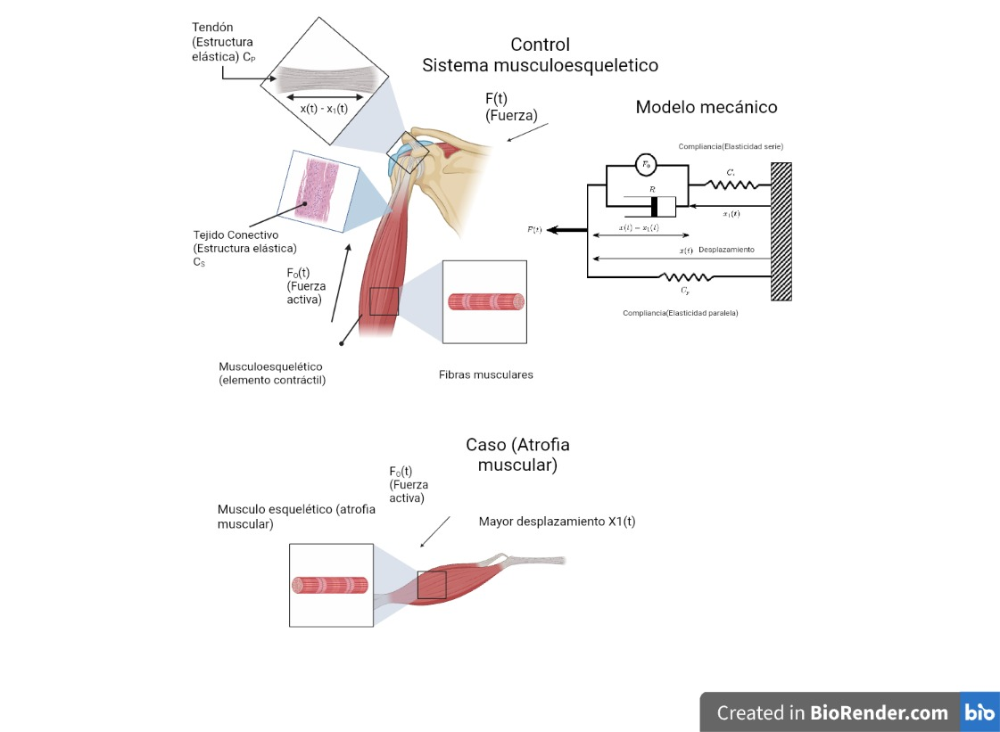
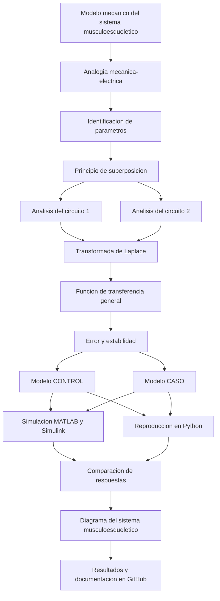

[](https://matlab.mathworks.com/open/github/v1?repo=23212203-EJB/MSFP3)

# Práctica 3 - Sistema musculoesquelético

Repositorio académico de la asignatura **Modelado de Sistemas Fisiológicos**, correspondiente al programa de **Ingeniería Biomédica** del Tecnológico Nacional de México / Instituto Tecnológico de Tijuana. Esta práctica integra modelado matemático, analogías eléctricas de sistemas fisiológicos, análisis de estabilidad y simulación computacional para estudiar el comportamiento mecánico del sistema musculoesquelético bajo diferentes condiciones fisiológicas.

El caso de estudio representa el comportamiento de la unidad músculo-tendón mediante un modelo mecánico equivalente a un circuito eléctrico. Se busca reproducir y comparar la respuesta del sistema en dos condiciones: **CONTROL (individuo sano)** y **CASO (atrofia muscular)**, considerando las diferencias en el amortiguamiento y el comportamiento del desplazamiento del tendón.

**Docente:** Dr. Paul Antonio Valle Trujillo  
**Correo:** paul.valle@tectijuana.edu.mx  
**Departamento:** Ingeniería Eléctrica y Electrónica  
**Institución:** Tecnológico Nacional de México / Instituto Tecnológico de Tijuana  
**Asignatura:** Modelado de Sistemas Fisiológicos  
**Programa:** Ingeniería Biomédica  
**Estudiante:** Ernesto Jáuregui Bogarin · 23212203 · L23212203@tijuana.tecnm.mx

**Repositorio:** MSFP3  
**Sede:** Blvd. Alberto Limón Padilla s/n, Tijuana, C. P. 22454, B. C., México.

---

<a id="contenido"></a>
## Contenido

1. [Resumen](#resumen)
2. [Competencia y objetivos](#objetivos)
3. [Relación con el temario](#temario)
4. [Modelo físico y analogía eléctrica](#analogia)
5. [Formulación matemática](#modelo)
6. [Análisis de estabilidad y error en estado estacionario](#analisis)
7. [Señal de entrada y condiciones de simulación](#senales)
8. [Implementación en MATLAB y Simulink](#matlab)
9. [Reproducción en Python](#python)
10. [Resultados y comparación de respuestas](#resultados)
11. [Diagrama del sistema musculoesquelético](#diagrama)
12. [Flujo de trabajo](#flujo)
13. [Actividades del estudiante](#actividades)
14. [Estructura del repositorio](#estructura)
15. [Requisitos](#requisitos)
16. [Reproducibilidad y entregables](#reproducibilidad)
17. [Referencias](#referencias)

---

<a id="resumen"></a>
## Resumen

La práctica tiene como propósito **modelar, analizar y simular el comportamiento del sistema musculoesquelético** mediante una analogía entre un modelo mecánico y un circuito eléctrico equivalente. El sistema representa la interacción entre el músculo esquelético, considerado como elemento contráctil, y el tendón, representado mediante una estructura elástica.

Se estudian dos condiciones fisiológicas: un individuo sano (CONTROL) y un individuo con atrofia muscular (CASO). Para representar ambas condiciones se utiliza la misma estructura del modelo mecánico, modificando principalmente el valor de la resistencia equivalente $R$, asociada al amortiguamiento viscoso del sistema.

El desarrollo matemático se realiza mediante el **principio de superposición**, debido a la presencia de dos fuentes de voltaje. A partir de este procedimiento se obtienen las contribuciones individuales de las corrientes $x_1(t)$ y $x_2(t)$, así como la función de transferencia que relaciona la fuerza de entrada $F(t)$ con la fuerza de salida $F_s(t)$.

Posteriormente, se implementan los modelos en MATLAB/Simulink y se reproducen sus respuestas mediante Python. Finalmente, se comparan los resultados obtenidos para las condiciones CONTROL y CASO, utilizando una señal de entrada escalón.

**Palabras clave:** sistema musculoesquelético; atrofia muscular; modelo mecánico; analogía eléctrica; principio de superposición; función de transferencia; estabilidad; MATLAB; Simulink; Python; simulaciones numéricas.

[Volver al contenido](#contenido)

---

<a id="objetivos"></a>
## Competencia y objetivos

### Competencia a desarrollar

Comprender y aplicar los fundamentos del modelado de sistemas fisiológicos mediante analogías entre sistemas mecánicos y eléctricos, utilizando herramientas matemáticas y computacionales para analizar el comportamiento de estructuras biológicas bajo diferentes condiciones fisiológicas.

### Objetivo general

Analizar y simular el comportamiento de un modelo matemático del sistema musculoesquelético mediante su representación mecánica y su circuito eléctrico equivalente, comparando las respuestas correspondientes a un individuo sano y a un individuo con atrofia muscular.

### Objetivos específicos

- Identificar los elementos mecánicos que representan el comportamiento del músculo esquelético y el tendón.
- Establecer la analogía entre las variables mecánicas y las variables eléctricas del modelo.
- Aplicar el principio de superposición para analizar las contribuciones individuales de las fuentes de voltaje.
- Determinar las corrientes $x_1(t)$ y $x_2(t)$ y su relación con la corriente de entrada $x(t)$.
- Obtener la función de transferencia del sistema mediante la transformada de Laplace.
- Analizar el error en estado estacionario y la estabilidad del sistema en lazo abierto.
- Implementar los modelos correspondientes a las condiciones CONTROL y CASO en MATLAB/Simulink.
- Reproducir las respuestas de los modelos matemáticos mediante Python.
- Comparar el comportamiento de ambas condiciones fisiológicas ante una entrada escalón.

[Volver al contenido](#contenido)

---

<a id="temario"></a>
## Relación con el temario

La práctica integra contenidos de la asignatura **Modelado de Sistemas Fisiológicos (IBF-1020)**, relacionando los fundamentos de modelado matemático y sistemas fisiológicos con herramientas de simulación computacional.

| Área | Contenidos aplicados |
|---|---|
| Modelado de sistemas fisiológicos | Representación mecánica del sistema musculoesquelético |
| Analogías eléctricas | Correspondencia entre fuerza, voltaje, desplazamiento, corriente y elementos pasivos |
| Análisis matemático | Principio de superposición y ecuaciones integro-diferenciales |
| Transformada de Laplace | Obtención de funciones de transferencia |
| Ingeniería de Control | Análisis del error en estado estacionario y estabilidad |
| Simulación computacional | Implementación de modelos en MATLAB, Simulink y Python |

El enfoque combina **Ingeniería de Control, Electrónica, Ciencias de la Computación y Fisiología**, de acuerdo con la competencia general de la asignatura.

[Volver al contenido](#contenido)

---

<a id="analogia"></a>
## Modelo físico y analogía eléctrica

### 1. Modelo mecánico del sistema musculoesquelético

El sistema musculoesquelético se representa mediante un modelo mecánico compuesto por un músculo esquelético, considerado como elemento contráctil, y un tendón, representado mediante una estructura elástica.

El modelo contempla los siguientes elementos:

| Elemento | Representación | Descripción |
|---|---|---|
| Músculo esquelético | Elemento contráctil | Genera la fuerza activa $F_0(t)$ |
| Tendón | Compliancia en serie $C_s$ | Representa la estructura elástica del tendón |
| Amortiguador viscoso | Resistencia $R$ | Representa el amortiguamiento del sistema |
| Elemento elástico paralelo | Compliancia $C_p$ | Representa la propiedad de almacenamiento elástico del modelo |

### 2. Condiciones fisiológicas analizadas

Se consideran dos condiciones del sistema musculoesquelético:

**CONTROL (individuo sano)**

Representa el comportamiento de referencia del sistema, con fibras musculares de contracción normal, propiedades elásticas normales y amortiguamiento de referencia.

**CASO (atrofia muscular)**

Representa una condición de atrofia muscular, caracterizada en el modelo por una menor sección transversal de las fibras musculares, menor fuerza generada, mayor desplazamiento del tendón y mayor amortiguamiento.

### 3. Analogía entre variables y elementos

El modelo mecánico se representa mediante un circuito eléctrico equivalente utilizando la analogía fuerza-voltaje.

| Sistema mecánico | Sistema eléctrico equivalente |
|---|---|
| Fuerza $F(t)$ | Voltaje $V(t)$ |
| Fuerza activa $F_0(t)$ | Fuente de voltaje $V_0(t)$ |
| Velocidad $dx(t)/dt$ | Corriente $I(t)$ |
| Desplazamiento $x(t)$ | Carga eléctrica $q(t)$ |
| Amortiguador viscoso $R$ | Resistencia $R$ |
| Compliancia en paralelo $C_p$ | Capacitancia $C_p$ |
| Compliancia en serie $C_s$ | Capacitancia $C_s$ |

### 4. Parámetros utilizados

Los parámetros del circuito eléctrico equivalente para ambas condiciones son:

| Parámetro | CONTROL (individuo sano) | CASO (atrofia muscular) |
|---|---:|---:|
| $F(t)$ | 1 V | 1 V |
| $F_0(t)$ | 0.25 V | 0.25 V |
| $C_s$ | 10 µF | 10 µF |
| $C_p$ | 100 µF | 100 µF |
| $R$ | 100 Ω | 10 kΩ |

La principal diferencia paramétrica entre ambas condiciones corresponde al valor de la resistencia $R$, que representa el amortiguamiento viscoso del modelo.

### 5. Variables del circuito

Durante el análisis mediante el principio de superposición se identifican las siguientes corrientes:

- $x(t)$: corriente total de entrada.
- $x_1(t)$: primera contribución de corriente.
- $x_2(t)$: segunda contribución de corriente.

La relación entre las corrientes es:

$$
\boxed{x(t)=x_1(t)+x_2(t)}
$$

Asimismo, la fuerza de salida se expresa como la suma de las contribuciones individuales:

$$
F_s(t)=F_{s1}(t)+F_{s2}(t)
$$

[Volver al contenido](#contenido)

---

<a id="modelo"></a>
## Formulación matemática

### 1. Principio de superposición

Debido a que el circuito contiene dos fuentes de voltaje, se aplica el principio de superposición para analizar individualmente la contribución de cada fuente sobre la respuesta total del sistema.

Se consideran dos circuitos independientes:

**Circuito 1: fuente $F_0(t)$ apagada**

Para este circuito se establecen las siguientes relaciones:

$$
x(t)=x_1(t)+x_2(t)
$$

$$
x(t)=C_p\frac{dF_{s1}(t)}{dt}
$$

$$
x_1(t)=C_s\frac{d[F(t)-F_{s1}(t)]}{dt}
$$

$$
x_2(t)=\frac{F(t)-F_{s1}(t)}{R}
$$

Aplicando la transformada de Laplace y desarrollando las expresiones anteriores, se obtiene:

\frac{C_sRs+1}
{R(C_p+C_s)s+1}
}
$$

**Circuito 2: fuente $F(t)$ apagada**

Para el segundo circuito se considera la relación:

$$
F_0(t)=\alpha F(t)
$$

La contribución de la segunda fuente se representa mediante:

$$
F_{s2}(t)=
\frac{1}{C_p+C_s}
\int -x(t)\,dt
$$

Aplicando la transformada de Laplace y desarrollando las expresiones correspondientes, se obtiene:

$$
\boxed{
\frac{F_{s2}(s)}{F(s)}
=
\frac{-\alpha}
{R(C_p+C_s)s+1}
}
$$

### 2. Función de transferencia general

Aplicando el principio de superposición, la fuerza de salida total se obtiene mediante la suma de las contribuciones individuales:

$$
F_s(s)=F_{s1}(s)+F_{s2}(s)
$$

Por lo tanto, la función de transferencia general del sistema es:

$$
\boxed{
G(s)=\frac{F_s(s)}{F(s)}
=
\frac{C_sRs+1-\alpha}
{R(C_p+C_s)s+1}
}
$$

Donde:

- $F(s)$: transformada de Laplace de la fuerza de entrada.
- $F_s(s)$: transformada de Laplace de la fuerza de salida.
- $R$: resistencia equivalente al amortiguamiento viscoso.
- $C_s$: compliancia en serie.
- $C_p$: compliancia en paralelo.
- $\alpha$: constante del modelo obtenida durante el desarrollo matemático.

### 3. Función de transferencia para CONTROL

Para el individuo sano se utilizan los siguientes parámetros:

$$
R=100\,\Omega
$$

$$
C_s=10\,\mu F,\qquad C_p=100\,\mu F
$$

$$
\alpha=0.25
$$

La función de transferencia correspondiente es:

$$
\boxed{
G_C(s)=
\frac{100(10\times10^{-6})s+1-0.25}
{100(100\times10^{-6}+10\times10^{-6})s+1}
}
$$

### 4. Función de transferencia para CASO

Para el caso de atrofia muscular se utilizan los siguientes parámetros:

$$
R=10\,k\Omega
$$

$$
C_s=10\,\mu F,\qquad C_p=100\,\mu F
$$

$$
\alpha=0.25
$$

La función de transferencia correspondiente es:

$$
\boxed{
G_A(s)=
\frac{(10\times10^3)(10\times10^{-6})s+1-0.25}
{(10\times10^3)(100\times10^{-6}+10\times10^{-6})s+1}
}
$$

Las funciones de transferencia representan las dos condiciones fisiológicas consideradas en la práctica y permiten comparar el comportamiento del modelo ante una misma señal de entrada.

[Volver al contenido](#contenido)

---

<a id="analisis"></a>
## Análisis de estabilidad y error en estado estacionario

### 1. Error en estado estacionario

A partir de la función de transferencia general y considerando una entrada escalón unitario, el profesor obtiene la siguiente expresión para el error en estado estacionario:

$$
e_{ss}=
\lim_{s\to0}
s\frac{1}{s}
\left(1-\frac{F_s(s)}{F(s)}\right)
$$

El resultado obtenido es:

$$
\boxed{e_{ss}=\alpha}
$$

Este resultado establece que el error en estado estacionario depende del factor $\alpha$ definido en el modelo.

### 2. Estabilidad en lazo abierto

Para analizar la estabilidad del sistema se considera el denominador de la función de transferencia:

$$
R(C_p+C_s)s+1=0
$$

El polo del sistema se expresa como:

$$
\boxed{
\lambda=-\frac{1}{R(C_p+C_s)}
}
$$

De acuerdo con el análisis matemático proporcionado por el profesor, el sistema es estable en lazo abierto.

[Volver al contenido](#contenido)

---

<a id="senales"></a>
## Señal de entrada y condiciones de simulación

La señal utilizada para evaluar el comportamiento de los modelos corresponde a una **entrada escalón**, representada mediante $F(t)$.

Esta señal se aplica a los dos subsistemas para comparar sus respectivas respuestas.

| Señal | Variable | Descripción |
|---|---|---|
| Entrada escalón | $F(t)$ | Fuerza de entrada aplicada al sistema |
| Salida CONTROL | $F_s(t)$ | Respuesta del modelo del individuo sano |
| Salida CASO | $F_s(t)$ | Respuesta del modelo con atrofia muscular |

La simulación permite observar las diferencias entre ambas condiciones fisiológicas utilizando los parámetros establecidos para cada modelo.

[Volver al contenido](#contenido)

---

<a id="matlab"></a>
## Implementación en MATLAB y Simulink

La implementación computacional se realiza mediante MATLAB y Simulink, utilizando dos subsistemas principales que representan las condiciones fisiológicas analizadas.

### 1. Subsistema CONTROL

El primer subsistema representa el modelo del individuo sano y utiliza los parámetros correspondientes a la condición CONTROL.

Dentro del subsistema se implementa el circuito eléctrico equivalente mediante componentes de Simulink/Simscape y se obtiene la respuesta correspondiente a la función de transferencia del modelo.

Se identifican las siguientes señales de salida:

- `F(t): Control CE` — respuesta del circuito eléctrico.
- `F(t): Control FT` — respuesta de la función de transferencia.

Estas señales se envían a un bloque Scope para visualizar y analizar el comportamiento del modelo.

### 2. Subsistema CASO

El segundo subsistema representa la condición de atrofia muscular. Conserva la estructura general del circuito equivalente, modificando los parámetros correspondientes al caso estudiado.

Se identifican las siguientes señales de salida:

- `F(t): Caso CE` — respuesta del circuito eléctrico.
- `F(t): Caso FT` — respuesta de la función de transferencia.
- `PID(t): Caso` — respuesta del circuito eléctrico del caso de atrofia muscular con el controlador PID asignado.

Las señales se envían al bloque Scope correspondiente para visualizar las respuestas obtenidas.

### 3. Diagrama general de simulación

El modelo general integra ambos subsistemas y permite aplicar una misma entrada escalón para comparar sus respuestas.

Asimismo, se utilizan bloques de entrada y salida mediante las etiquetas `From` y `Goto` para organizar y transferir las señales dentro del diagrama de Simulink.

Los bloques Scope permiten visualizar las respuestas correspondientes a CONTROL y CASO.

**Abreviaturas utilizadas:**

- **CE:** Circuito Eléctrico.
- **FT:** Función de Transferencia.
- **PID:** Controlador Proporcional-Integral-Derivativo.

[Volver al contenido](#contenido)

---

<a id="python"></a>
## Reproducción en Python

La implementación en Python se realiza mediante **Visual Studio Code**, con el propósito de reproducir y comparar las respuestas obtenidas en MATLAB/Simulink.

El programa permite representar las funciones de transferencia correspondientes a las condiciones CONTROL y CASO, aplicar la señal de entrada escalón y visualizar las respuestas del sistema.

Los principales elementos que se consideran en la implementación son:

1. Definición de los parámetros del modelo CONTROL.
2. Definición de los parámetros del modelo CASO.
3. Construcción de las funciones de transferencia.
4. Definición de la señal de entrada escalón.
5. Simulación de las respuestas de ambos modelos.
6. Generación de gráficas para comparar los resultados.
7. Almacenamiento de las figuras obtenidas.

Las respuestas generadas mediante Python se utilizan para contrastar el comportamiento de los modelos con los resultados obtenidos en MATLAB/Simulink.

[Volver al contenido](#contenido)

---

<a id="resultados"></a>
## Resultados y comparación de respuestas

Los resultados de la práctica permiten comparar el comportamiento del sistema musculoesquelético bajo las dos condiciones fisiológicas establecidas.

### 1. Resultados de CONTROL

Se presenta la respuesta del modelo correspondiente al individuo sano, utilizando una resistencia de $100\,\Omega$ y los valores establecidos para las compliancias $C_s$ y $C_p$.

### 2. Resultados de CASO

Se presenta la respuesta del modelo correspondiente a la condición de atrofia muscular, utilizando una resistencia de $10\,k\Omega$ y conservando los valores de las compliancias.

### 3. Comparación entre condiciones

La comparación de ambas respuestas permite observar la influencia del cambio en el amortiguamiento del sistema sobre el comportamiento dinámico del modelo.

Se consideran los siguientes aspectos para el análisis:

- Diferencias entre las respuestas de CONTROL y CASO.
- Comportamiento de las salidas obtenidas mediante el circuito eléctrico equivalente.
- Comparación entre las respuestas de los circuitos eléctricos y las funciones de transferencia.
- Concordancia entre los resultados obtenidos en MATLAB/Simulink y Python.
- Interpretación de las diferencias observadas en relación con las condiciones fisiológicas representadas.

**Resultados del estudiante:** incorporar las gráficas obtenidas en las simulaciones, así como una interpretación de las diferencias entre ambas condiciones.

[Volver al contenido](#contenido)

---

<a id="diagrama"></a>
## Diagrama del sistema musculoesquelético

A continuación, se presenta una representación gráfica del modelo del sistema musculoesquelético, elaborada en **BioRender**, que permite visualizar los elementos mecánicos involucrados y su relación con las dos condiciones fisiológicas estudiadas.

El diagrama contempla las siguientes representaciones:

- **CONTROL:** individuo sano, con fibras musculares de contracción normal y propiedades elásticas de referencia.
- **CASO:** individuo con atrofia muscular, representado mediante una menor sección transversal de las fibras musculares y un mayor desplazamiento del tendón.
- **Modelo mecánico:** representación equivalente de la interacción entre el músculo esquelético, el tendón y los elementos elásticos del sistema.

La ilustración permite complementar el modelo matemático y la analogía eléctrica, facilitando la interpretación de los cambios mecánicos asociados a la condición de atrofia muscular.

![Diagrama del sistema musculoesquelético: comparación entre CONTROL y CASO (atrofia muscular)]
<sub>Figura 1. Representación del sistema musculoesquelético en condiciones CONTROL y CASO (atrofia muscular). Elaboración propia mediante BioRender.</sub>

[Volver al contenido](#contenido)

---

<a id="flujo"></a>
## Flujo de trabajo



El procedimiento integra el análisis matemático, la representación mediante circuitos eléctricos equivalentes y la simulación computacional de las dos condiciones fisiológicas.

[Volver al contenido](#contenido)

---

<a id="actividades"></a>
## Actividades del estudiante

La práctica contempla las siguientes actividades para el desarrollo y análisis del modelo matemático:

### Etapa 1. Modelo físico y analogía eléctrica

- [ ] Identificar los elementos mecánicos del sistema musculoesquelético.
- [ ] Establecer la correspondencia entre las variables mecánicas y eléctricas.
- [ ] Identificar las fuentes de voltaje y los elementos pasivos del circuito.
- [ ] Registrar los parámetros correspondientes a CONTROL y CASO.

### Etapa 2. Desarrollo matemático

- [ ] Aplicar el principio de superposición.
- [ ] Analizar individualmente los dos circuitos.
- [ ] Obtener las contribuciones de las corrientes $x_1(t)$ y $x_2(t)$.
- [ ] Aplicar la transformada de Laplace.
- [ ] Obtener la función de transferencia general.
- [ ] Identificar las funciones de transferencia de CONTROL y CASO.
- [ ] Analizar el error en estado estacionario.
- [ ] Determinar la estabilidad en lazo abierto.

### Etapa 3. Simulación computacional

- [ ] Implementar el modelo CONTROL en Simulink.
- [ ] Implementar el modelo CASO en Simulink.
- [ ] Aplicar la señal de entrada escalón.
- [ ] Obtener las respuestas de los circuitos eléctricos equivalentes.
- [ ] Obtener las respuestas de las funciones de transferencia.
- [ ] Implementar el controlador PID asignado al circuito eléctrico del CASO.
- [ ] Reproducir los modelos en Python.
- [ ] Generar y almacenar las gráficas correspondientes.

### Etapa 4. Comparación y documentación

- [ ] Comparar las respuestas de CONTROL y CASO.
- [ ] Contrastar los resultados de MATLAB/Simulink y Python.
- [ ] Interpretar las diferencias entre las dos condiciones fisiológicas.
- [ ] Incorporar el diagrama del sistema musculoesquelético elaborado en BioRender.
- [ ] Incorporar las gráficas y evidencias de simulación.
- [ ] Documentar los resultados en el repositorio de GitHub.

[Volver al contenido](#contenido)

---

<a id="estructura"></a>
## Estructura del repositorio

Una organización sugerida para los archivos de la práctica es:

```text
MSFP3/
│
├── README.md
│
├── Calculos_matematicos.pdf
│
├── Modelo_Simulink/
│   └── modelo_musculoesqueletico.slx
│
├── MATLAB/
│   └── simulacion_control_caso.m
│
├── Python/
│   └── modelo_musculoesqueletico.py
│
├── Imagenes/
│   ├── diagrama_sistema_musculoesqueletico.jpeg
│   ├── modelo_mecanico.png
│   ├── circuito_electrico.png
│   └── diagrama_simulink.png
│
└── Resultados/
    ├── control/
    ├── caso/
    └── comparacion/
```

**Nota:** esta estructura es una propuesta organizativa. Los nombres de los archivos pueden modificarse de acuerdo con los documentos y programas finales incluidos en el repositorio. La imagen de BioRender debe colocarse en la carpeta `Imagenes` con el nombre utilizado en el enlace del README.

[Volver al contenido](#contenido)

---

<a id="requisitos"></a>
## Requisitos

### Software

- **MATLAB:** para el análisis y procesamiento de los modelos matemáticos.
- **Simulink:** para implementar y simular los circuitos eléctricos equivalentes.
- **Python:** para reproducir las funciones de transferencia y generar las gráficas.
- **Visual Studio Code:** entorno de desarrollo utilizado para ejecutar los programas de Python.
- **Git y GitHub:** para organizar y documentar los archivos de la práctica.

Las bibliotecas de Python necesarias deberán corresponder a las utilizadas en el programa de simulación.

[Volver al contenido](#contenido)

---

<a id="reproducibilidad"></a>
## Reproducibilidad y entregables

### Secuencia de reproducción

1. Consultar el material de referencia proporcionado para la práctica.
2. Identificar los elementos del modelo mecánico y su analogía eléctrica.
3. Registrar los parámetros correspondientes a CONTROL y CASO.
4. Aplicar el principio de superposición para obtener las contribuciones individuales del sistema.
5. Obtener la función de transferencia general mediante la transformada de Laplace.
6. Identificar las funciones de transferencia correspondientes a las dos condiciones fisiológicas.
7. Analizar el error en estado estacionario y la estabilidad en lazo abierto.
8. Implementar los modelos en MATLAB/Simulink.
9. Aplicar la entrada escalón y obtener las respuestas de ambos subsistemas.
10. Reproducir los modelos mediante Python.
11. Comparar las respuestas obtenidas y documentar los resultados.
12. Incorporar el diagrama del sistema musculoesquelético y las evidencias correspondientes.
13. Publicar los archivos y la documentación en el repositorio de GitHub.

### Resultados esperados

| Entregable | Evidencia |
|---|---|
| Modelo físico | Representación mecánica del sistema musculoesquelético |
| Analogía eléctrica | Circuito equivalente y correspondencia de variables |
| Desarrollo matemático | Principio de superposición y transformada de Laplace |
| Función de transferencia | Expresión general y modelos CONTROL y CASO |
| Análisis del sistema | Error en estado estacionario y estabilidad |
| MATLAB/Simulink | Modelo de simulación y resultados |
| Python | Código fuente y gráficas de las respuestas |
| Comparación | Análisis de las condiciones CONTROL y CASO |
| Diagrama | Ilustración del sistema musculoesquelético elaborada en BioRender |
| Documentación | README.md y archivos del repositorio |

### Criterios de presentación académica

El repositorio debe permitir identificar claramente el procedimiento matemático, los parámetros utilizados y los resultados obtenidos mediante las simulaciones.

Se debe distinguir entre las condiciones fisiológicas estudiadas y conservar la correspondencia entre los parámetros del modelo, las funciones de transferencia y las implementaciones computacionales.

[Volver al contenido](#contenido)

---

<a id="referencias"></a>
## Referencias

[1] P. A. Valle, *Syllabus para Modelado de Sistemas Fisiológicos*, Tecnológico Nacional de México / Instituto Tecnológico de Tijuana, Tijuana, B. C., México. Disponible en: https://biomath.xyz/course/

[2] P. A. Valle, *Material de clase y desarrollo matemático de la Práctica 3: Sistema musculoesquelético*, Modelado de Sistemas Fisiológicos, Tecnológico Nacional de México / Instituto Tecnológico de Tijuana, 2026.

---

## Uso académico

Este repositorio corresponde a la **Práctica 3 de Modelado de Sistemas Fisiológicos**, cuyo propósito es estudiar el comportamiento de un modelo mecánico del sistema musculoesquelético mediante su representación eléctrica equivalente.

El desarrollo contempla el análisis matemático mediante el principio de superposición, la obtención de funciones de transferencia y la simulación computacional de dos condiciones fisiológicas: un individuo sano y un individuo con atrofia muscular.

Los resultados permiten comparar el comportamiento de ambos modelos y reforzar los conocimientos relacionados con el modelado matemático y la simulación de sistemas fisiológicos.
